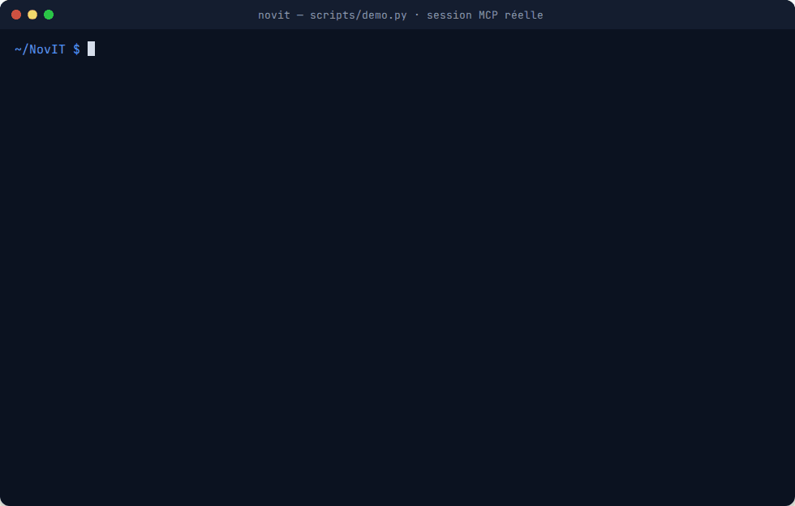
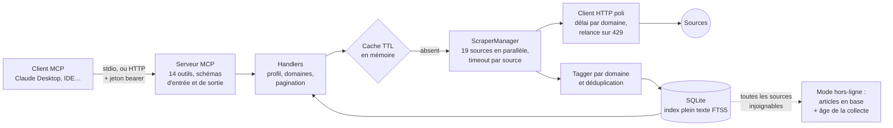

<p align="center">
  <picture>
    <source media="(prefers-color-scheme: dark)" srcset="docs/assets/logo-dark.png">
    
  </picture>
</p>

<p align="center">
  <a href="https://github.com/rmouahid/NovIT/actions/workflows/ci.yml"></a>
  <a href="LICENSE"></a>
  
</p>

**NovIT est un serveur MCP qui donne à Claude, et à tout client MCP,
l'actualité tech du jour : il collecte 19 sources (actualités, IA, sécurité,
ingénierie, réglementation, formation), les classe selon le profil de
l'utilisateur et renvoie des réponses citables, en Markdown et en données
structurées.**

<p align="center">
  
  <br>
  <sub>Session réelle enregistrée avec <a href="scripts/demo.py"><code>scripts/demo.py</code></a> : le serveur est lancé en stdio et interrogé par le client MCP du SDK, comme le ferait Claude Desktop.</sub>
</p>

## Fonctionnement



- **14 outils MCP** : actualités par profil et par domaine, résumé du jour,
  recherche plein texte, tendances, articles liés, lecture d'un article,
  préférences, retours utilisateur et santé du serveur. Chaque outil déclare
  son schéma d'entrée et ses annotations (lecture seule ou non) ; les trois
  outils d'articles déclarent aussi un schéma de sortie et renvoient les
  articles en `structuredContent`.
- **Deux profils** : ETUDIANT (pédagogique) et INGENIEUR (technique et
  concis), qui changent les sources prioritaires, les domaines et le ton.
- **Respect des sources** : toutes les requêtes passent par un client qui
  impose un délai minimal par domaine (6 s pour NVD sans clé, 3 s pour
  arXiv), relance après un 429 en respectant `Retry-After` et s'identifie
  avec `NOVIT_USER_AGENT`.
- **Robuste aux pannes** : une source en erreur n'arrête pas la collecte ;
  si toutes échouent, NovIT sert les articles en base avec la date de la
  dernière collecte réussie et relance la collecte en arrière-plan.

## Résultats

| Mesure | Valeur |
|---|---:|
| Collecte complète des 19 sources, en parallèle (médiane de 3) | 2,0 s |
| Sources qui répondent | 19 sur 19 |
| Articles uniques collectés | 1 783 |
| Tests automatisés (unitaires, intégration, client MCP réel sur stdio) | 352 |

Mesures du 6 novembre 2026 sur un VPS à 1 vCPU. Pour les reproduire :

```bash
python scripts/profile_scrapers.py --top 10   # temps total, état et volume par source
pytest -q                                     # dont tests/test_stdio_client.py
```

La collecte complète prenait 6 à 9 s avant le passage des flux RSS en
asynchrone ([docs/PERFORMANCE.md](docs/PERFORMANCE.md)).

## Choix techniques et limites

**Choix**

- **Le protocole MCP plutôt qu'une API maison.** Le même serveur sert
  Claude Desktop, les IDE et tout client MCP, sans intégration spécifique ;
  le schéma de chaque outil documente le contrat, et les tests valident
  chaque réponse contre lui avec le client du SDK.
- **Des sources ouvertes (RSS, API publiques) plutôt que du scraping
  HTML.** Moins de casse et pas de contournement des protections des
  sites ; une source qui n'a plus de flux est retirée plutôt que scrapée.
- **SQLite et FTS5.** Un seul fichier, une recherche par mots entiers
  classée par pertinence, aucun service à installer ni à héberger.
- **Un cache TTL en mémoire.** Une heure pour les actualités, trente
  minutes pour les recherches : la plupart des appels ne touchent pas le
  réseau ([ADR-003](docs/ADR/0003-strategie-cache-ttl.md)).
- **stdio par défaut, HTTP en option.** En local, le client lance le
  serveur lui-même ; pour un déploiement distant, `novit --transport http`
  sert `/mcp` derrière un jeton bearer, avec des préférences séparées par
  utilisateur.

**Limites**

- Pas d'instance publique : le déploiement sur Fly.io est préparé
  (`fly.toml`, [docs/CLOUD_DEPLOYMENT.md](docs/CLOUD_DEPLOYMENT.md)) mais
  pas en ligne.
- Le classement par profil repose sur des mots-clés et des scores de
  source, pas sur un modèle : un article mal tagué remonte dans le mauvais
  domaine.
- Des sources de référence n'ont pas de flux ouvert (blog d'Anthropic,
  EUR-Lex) et ne sont donc pas couvertes.
- Le cache est en mémoire : il repart de zéro à chaque redémarrage du
  serveur.

## Démarrage rapide

Prérequis : Python 3.11 ou plus.

```bash
git clone https://github.com/rmouahid/NovIT.git && cd NovIT
python -m venv .venv && .venv/bin/pip install .   # installe la commande novit
.venv/bin/python scripts/demo.py                  # session MCP réelle sur les sources en direct
```

Pour l'utiliser dans Claude Desktop, copier
[`examples/claude_desktop_config.json`](examples/claude_desktop_config.json)
dans sa configuration MCP (Settings → Developer → Edit Config), puis
redémarrer l'application. Avec Docker : `docker compose up -d`. Détails et
dépannage : [docs/INSTALLATION_GUIDE.md](docs/INSTALLATION_GUIDE.md).

## Documentation

| Document | Contenu |
|---|---|
| [docs/USER_GUIDE.md](docs/USER_GUIDE.md) | outils, profils, sources, exemples de questions |
| [docs/TECHNICAL_DOCUMENTATION.md](docs/TECHNICAL_DOCUMENTATION.md) | modules, outils MCP, débogage |
| [docs/RESPONSE_FORMATS.md](docs/RESPONSE_FORMATS.md) | formats de réponse et schéma de sortie |
| [docs/ARCHITECTURE.md](docs/ARCHITECTURE.md) · [docs/ADR/](docs/ADR/) | architecture et décisions |
| [docs/PLUGINS.md](docs/PLUGINS.md) | ajouter une source sans modifier le dépôt |
| [CONTRIBUTING.md](CONTRIBUTING.md) | contribuer, tests, conventions |

## Licence

[MIT](LICENSE)
